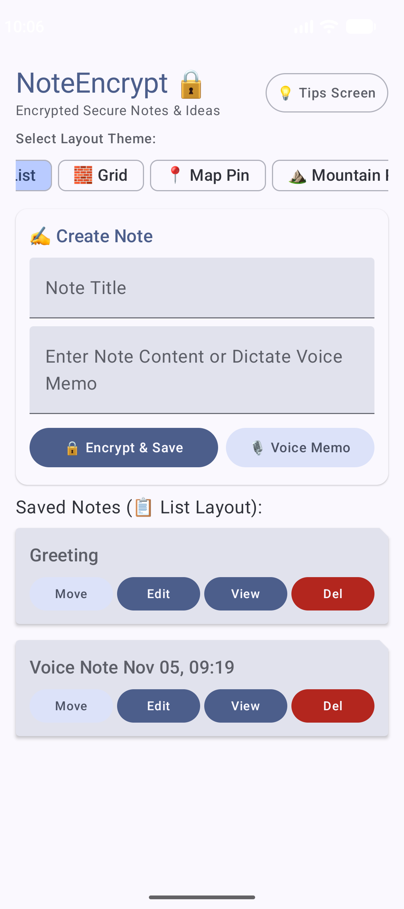
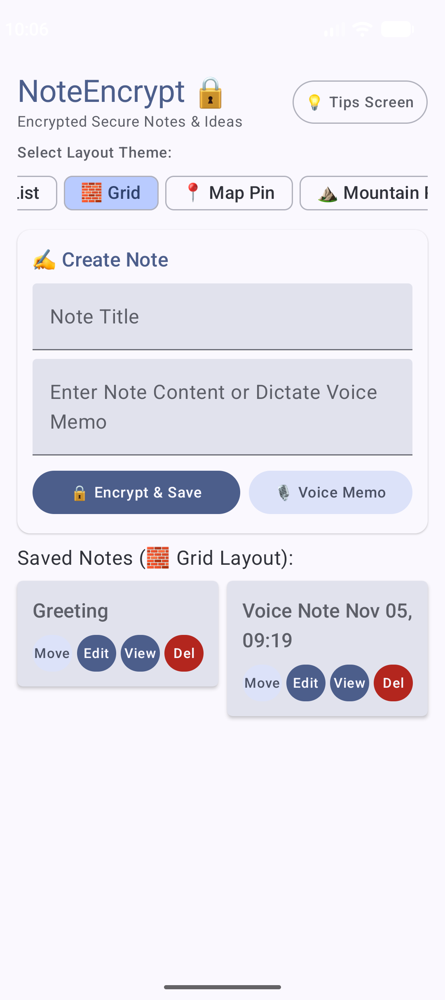
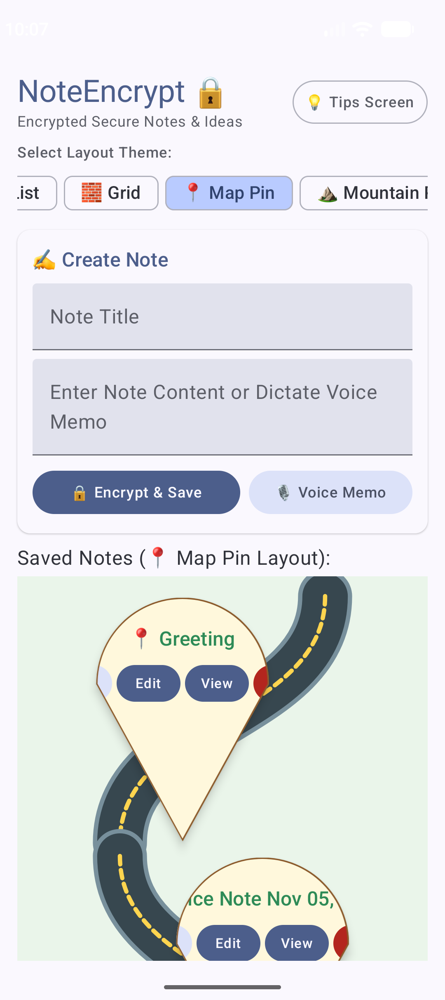
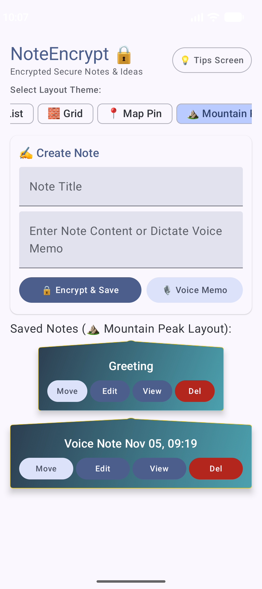
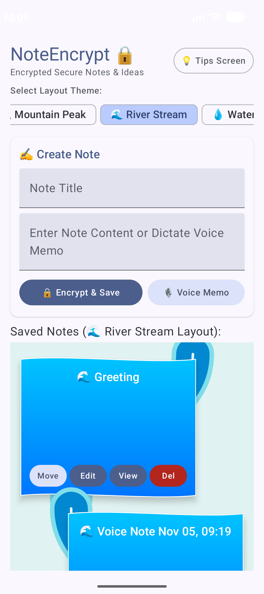
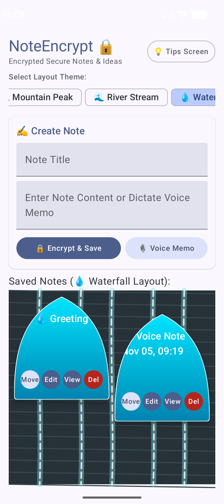

# NoteEncrypt 🔒

**NoteEncrypt** is a modern, privacy-focused Android note-taking application built with **Jetpack Compose**, **Android KeyStore hardware-backed AES/GCM encryption**, **Room Database**, and an immersive **multi-module architectural layout**.

NoteEncrypt provides zero-knowledge local storage for sensitive notes, credentials, and audio voice memos, protecting data at rest using strong cryptographic standards while offering fluid note management across 6 creative visual layout themes.

---

## 📸 Layout Theme Gallery

Explore the 6 visual layout themes offered in NoteEncrypt:

| 📋 List Layout | 🧱 Grid Layout | 📍 Map Pin Layout |
| :---: | :---: | :---: |
|  |  |  |

| ⛰️ Mountain Peak Layout | 🌊 River Stream Layout | 💧 Waterfall Layout |
| :---: | :---: | :---: |
|  |  |  |

---

## 🌟 Key Features

### 🔒 Hardware-Backed AES/GCM Encryption
- **Android KeyStore Integration**: AES keys are securely generated and stored inside the Android hardware-backed KeyStore framework (`AndroidKeyStore`).
- **AES/GCM/NoPadding**: Authenticated Encryption with Associated Data (AEAD) ensures note payload confidentiality and integrity.
- **Zero-Knowledge Memory**: Notes remain encrypted on disk in the Room database and are decrypted asynchronously off the UI thread only when actively viewed or edited.

### 🎙️ Encrypted Voice Memos & Audio Recording
- **Integrated Voice Dictation**: Capture spontaneous thoughts and audio memos directly using the device microphone (`MediaRecorder`).
- **Animated Audio Waveform**: Built-in 16-bar animated visualizer during audio playback (`MediaPlayer`).
- **Encrypted Audio Payloads**: Voice recording metadata and file references are formatted and encrypted alongside note titles.

### 🎨 6 Creative Thematic Visual Layouts
Switch effortlessly between custom visual card shape geometries and rendering styles:
1. **📋 List**: Classic folded notepad paper sheet layout (`NotepadSheetShape`).
2. **🧱 Grid**: 2-column brick tile layout (`BrickTileShape`).
3. **📍 Map Pin**: Location marker card layout (`MapPinShape`).
4. **⛰️ Mountain Peak**: Alpine summit silhouette card layout (`MountainPeakShape`).
5. **🌊 River Stream**: Wave-curved layout with horizontal color gradients (`RiverStreamShape`).
6. **💧 Waterfall**: Staggered grid layout with waterdrop-shaped cards (`WaterfallDropShape`).

### 🎯 Interactive Card Reordering & Management
- **Tap-to-Target Card Moving**: Tap any card to highlight it as a move target, then tap a target slot to instantly reorder notes.
- **Edit & Re-Encrypt**: Decrypt note contents, modify plain text or titles, and re-encrypt seamlessly.
- **Tips & Guide Screen**: Dedicated guide screen presenting note-taking best practices, security overview, and dictation tips.

---

## 🏗️ Project Architecture & Modules

NoteEncrypt follows clean architecture principles organized across 3 Gradle sub-projects:

```
NoteEncrypt/
├── app/                  # Main Android Application module (UI, Navigation, ViewModel)
│   └── src/main/java/com/example/noteencrypt/
│       ├── MainActivity.kt        # Entry point & Navigation host
│       ├── NoteViewModel.kt       # StateFlow / Compose State business logic
│       ├── SecureNotesUI.kt       # Main dashboard, layout engines & custom card shapes
│       ├── EditScreen.kt          # Note editing, decryption & audio preview
│       ├── TipsScreen.kt          # Best practices & note-taking guide screen
│       ├── VoiceMemoManager.kt    # MediaRecorder & MediaPlayer audio controller
│       └── ui/theme/              # Material 3 Color, Theme, & Type definitions
├── encryption/           # Cryptographic Security Library module
│   └── src/main/java/com/example/encryption/
│       └── KeyStoreHelper.kt      # Android KeyStore secret key generation, AES/GCM encrypt/decrypt
└── data/                 # Data Persistence Library module
    └── src/main/java/com/example/data/
        ├── Note.kt                # Room Entity definition (@Entity)
        ├── NoteDao.kt             # Data Access Object (@Dao)
        ├── NoteDatabase.kt        # RoomDatabase singleton configuration
        └── NoteRepository.kt      # Repository abstraction layer (Dispatchers.IO)
```

---

## 🛠️ Tech Stack & Dependencies

- **Language**: [Kotlin](https://kotlinlang.org/)
- **UI Framework**: [Jetpack Compose](https://developer.android.com/jetpack/compose) with Material 3 Design System
- **Navigation**: [Jetpack Navigation Compose](https://developer.android.com/jetpack/compose/navigation)
- **Database**: [Room Database](https://developer.android.com/training/data-storage/room) with KSP annotation processor
- **Security**: Hardware-Backed [Android KeyStore](https://developer.android.com/training/articles/keystore) with `AES/GCM/NoPadding`
- **Audio Processing**: [MediaRecorder](https://developer.android.com/reference/android/media/MediaRecorder) & [MediaPlayer](https://developer.android.com/reference/android/media/MediaPlayer)
- **Concurrency**: [Kotlin Coroutines](https://kotlinlang.org/docs/coroutines-overview.html) (`Dispatchers.IO`, `Dispatchers.Main`)

---

## 🚀 Getting Started

### Prerequisites
- **Android Studio**: Ladybug / 2024.2+ or Android Studio Jellyfish / Koala.
- **JDK**: Java 11 or higher.
- **Min SDK**: API 26 (Android 8.0 Oreo).
- **Target SDK**: API 37.

### Building & Running
1. Clone or extract the repository:
   ```bash
   git clone https://github.com/your-username/NoteEncrypt.git
   cd NoteEncrypt
   ```
2. Open the project folder in **Android Studio**.
3. Allow Gradle to sync dependencies automatically.
4. Select the `:app` run configuration and click **Run** (or press `Shift + F10`) on an Android Virtual Device (emulator) or connected physical device.

---

## 🧪 Testing

The project includes both local unit tests and instrumented tests across all three modules (`:app`, `:data`, `:encryption`).

To run unit tests via Gradle:
```bash
./gradlew test
```

To run instrumented Android tests on a connected device/emulator:
```bash
./gradlew connectedAndroidTest
```

---

## 📄 License

Distributed under the MIT License. See `LICENSE` for more information.
